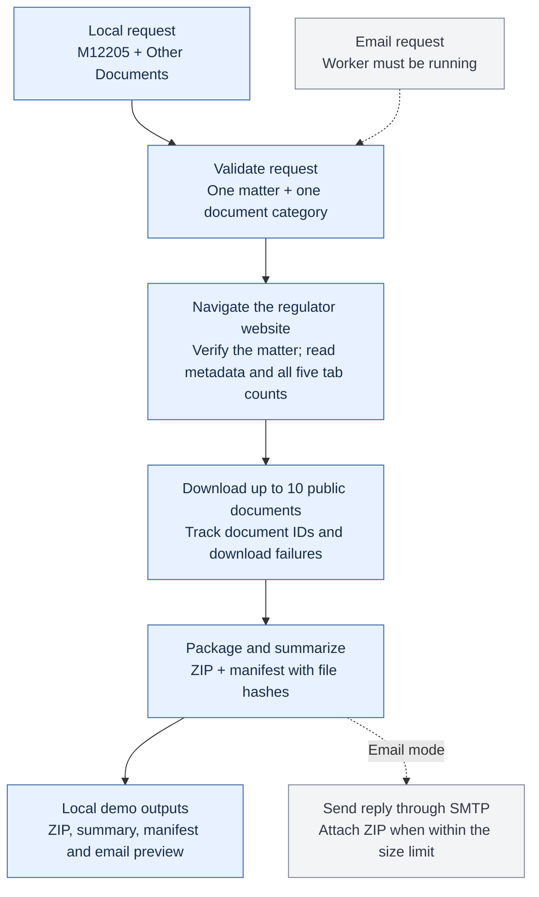

# Regulatory document email agent

A small Python pipeline for the Nova Scotia public documents database. It accepts a matter number and one document category, reads live metadata and all five tab counts, downloads up to ten public documents, builds a ZIP with an evidence manifest, and prepares or sends an email reply.

The default request parser is deterministic and accepts singular or plural category names, such as “Other Document” and “Other Documents”. An optional OpenAI classifier is available with `--ai`; it interprets document categories only. Browser navigation, counts, filenames, recipients and packaging remain ordinary code.

## How it works

The local demo follows the solid arrows. The email worker uses the same processing steps, with an additional inbox reader and SMTP sender.



**What is demonstrated locally:** live website retrieval and creation of the ZIP, summary, manifest, and email preview. No email is sent by the local demo command. If no files are downloaded, no ZIP is created. Optional email delivery requires mailbox credentials and a running worker.

## Reviewer quick start (Python 3.10+)

Clone or download this repository, then open a terminal inside it. The commands below run locally and do not require an email password or an AI API key. An internet connection is needed for live document retrieval.

### Windows

In a terminal inside this folder:

```powershell
py -m venv .venv
.\.venv\Scripts\python.exe -m pip install -r requirements.txt
.\.venv\Scripts\python.exe -m playwright install chromium
.\.venv\Scripts\python.exe -m unittest -v
```

### macOS / Linux

```bash
python3 -m venv .venv
.venv/bin/python -m pip install -r requirements.txt
.venv/bin/python -m playwright install chromium
.venv/bin/python -m unittest -v
.venv/bin/python agent.py run --text "Please send Other Documents from M12205"
```

Linux may require system browser dependencies: `.venv/bin/python -m playwright install --with-deps chromium`.

### Run on Windows

No email credentials or AI API key are needed to fetch real documents locally:

```powershell
.\.venv\Scripts\python.exe agent.py run --text "Please send Other Documents from M12205"
```

Add `--headed` to watch the browser. Each timestamped `runs/` folder contains `reply.txt`, `reply.eml`, `manifest.json`, a screenshot, downloaded files, and a ZIP when files are available. The terminal prints the exact output path. Open `reply.eml` in a mail client to inspect the real MIME attachment; this does not send it.

Offline fallback:

```powershell
.\.venv\Scripts\python.exe agent.py run --demo
```

This creates ten synthetic text files and clearly labels the output. It is a packaging demonstration, not proof of live retrieval. Demo mode cannot send email.

## Connect the reviewer-facing mailbox

Use a dedicated mailbox with provider-supported IMAP and SMTP authentication. Copy `.env.example` to `.env` and set the address, account username, provider hostnames, and a provider-issued app password if supported. The program supports password/app-password authentication; OAuth-only accounts require another adapter. Never commit `.env`.

The Gmail/Drive connections in a chat do not automatically authenticate this standalone process. The mailbox still needs its own credentials. Provider settings should come from that provider's current documentation.

1. Configure `.env` locally. `AGENT_EMAIL` is the address to put in the submission.
2. Send a test request **yourself** from another address to that mailbox: `Please send Other Documents from M12205`. Any subject is fine, such as `Document request`.
3. Preview one poll without sending:

```powershell
.\.venv\Scripts\python.exe agent.py watch --once
```

4. Inspect `runs/mail/<job>/reply.txt` and `reply.eml`.
5. Start automatic replies when ready:

```powershell
.\.venv\Scripts\python.exe agent.py watch --send
```

The worker will send any saved previews when `--send` is enabled. Run it only on the intended dedicated inbox. With `SUBJECT_PREFIX=` blank, it processes up to twenty unread candidates per poll without requiring a special subject. For a personal inbox, set `SUBJECT_PREFIX=[Regulatory Agent]` to restrict processing; messages without that prefix will be left untouched. If the setting is omitted entirely, the personal-inbox prefix is the safe default. It ignores automated replies and mailing lists, and replies to the From address. Optional `ALLOWED_SENDERS` restricts who it serves; include the reviewers if using that setting. Header allowlisting is a demo control, not sender authentication.

Keep the process running and the computer awake while reviewers test it. For reliable availability, use an always-on host with Python and Playwright, persist the `runs/mail` directory, and restart the worker after reboots. This repository is not a deployed service and does not create an email address.

A single explicit test send is also available:

```powershell
.\.venv\Scripts\python.exe agent.py run --text "M12205 Key Documents" --to YOUR_TEST_ADDRESS --send
```

Only use `--send` after replacing the recipient and checking the mailbox settings.

## Optional AI interpretation

Set `OPENAI_API_KEY` and `OPENAI_MODEL` to a model available in your account, then add `--ai` to `run` or `watch`. For example, it can classify “audio files” as Recordings. It sends the subject/body text to the OpenAI Responses API; it never sends downloaded documents. Without `--ai`, no model API is contacted.

The matter must still be exactly one `M` plus five digits. Explicit multiple document categories are rejected. Model output must be one of the five allowed labels and cannot override an explicit category. Missing or uncertain intent returns a clarification. Counts and metadata never come from the model.

API reference: https://developers.openai.com/api/docs/guides/text

## Design and boundaries

- `core.py`: validated requests, optional AI classification, file hashes, ZIP and MIME creation.
- `browser.py`: the FileMaker adapter, with selectors kept in one place.
- `agent.py`: CLI, IMAP polling, SMTP delivery, and SQLite job journal.
- `test_agent.py`: offline tests, including mocked AI responses; no email is sent by tests.

FileMaker only makes a field editable after activation and renders record data after layout creation. The adapter waits for those states and verifies the returned matter number. It reads all five count labels, then uses document IDs to avoid confusing recycled table rows. Downloads use the site's GO GET IT dialog. A ZIP manifest records IDs, titles, file sizes, retrieval time, and SHA-256 hashes.

The total is the **sum of tab entry counts**, not a claim that all files are unique across categories. Source date labels are preserved: Date Received and Decision Date. The script does not reinterpret them as first/last filing dates.

## Limits and recovery

- The initial metadata layout and row field identifiers are site-specific. A site redesign may require updating `browser.py`.
- The agent takes up to ten public entries encountered in current site order. It does not promise a chronological sort or fetch confidential entries. One file is taken from each selected record; multi-attachment records are not exhaustively enumerated.
- FileMaker list traversal has a time/scroll bound. Partial results explicitly report download errors and the number actually downloaded.
- Zero documents produces an informative response without an empty ZIP.
- The encoded email has a configurable 20 MB limit. If exceeded, it sends a size-limit explanation without the ZIP; automatic splitting or hosted links are not implemented. Downloads are not stream-size-limited, so large recordings need disk space.
- SQLite avoids ordinary duplicate processing. `sending` means delivery may be uncertain after a crash or SMTP timeout. Check the recipient mailbox/provider logs before manually retrying. SMTP cannot offer exactly-once delivery.
- `failed` jobs require operator review. Run a corrected request manually, or remove that specific journal row only after checking whether anything was sent. Do not delete the whole journal to retry one job.
- A `.worker.lock` prevents two workers sharing the same journal. After a hard crash, check the recorded PID is no longer running before removing the stale lock.
- Website errors create `failure.png` and a local error log; a failed browser job currently requires operator intervention rather than emailing a fabricated result.
- No rate-limiting per sender, distributed workers, OAuth flow, or hosted deployment in this timeboxed version.

## Tested behavior

19 offline tests pass. Live testing covered ten Other Documents, all six Key Documents, zero Transcripts, and seven public Exhibits with confidential entries skipped for M12205. The complete incoming-email-to-ZIP-reply workflow was also tested through Gmail, including an ordinary-subject request to the dedicated account. The initial site load sometimes takes over 30 seconds; the adapter allows 90 seconds.

Optional AI inference has been tested with mocked API responses only. Nonempty Recordings and Transcripts and all other matter layouts have not been exhaustively tested. This repository is not an always-on deployment.

## Running the email worker

Reviewers can test the core retrieval without any credentials. To test email on their own computer, they should configure a mailbox they control using `.env.example`; no account passwords or tokens are included in this repository. The owner’s dedicated agent address is `michelle.regulatory.agent@gmail.com`, but email replies require the worker to be running.

For a dedicated inbox, keep `SUBJECT_PREFIX=` blank. Example email body: `Please send me Other Documents from M12205.` Any subject is accepted. Use the prefix setting only if sharing a personal inbox.

## Full email demo with a visible browser

After configuring your own dedicated mailbox in `.env`, send it a fresh email from another address containing `Please send Other Documents from M12205`. Leave the request unread, then run:

```powershell
.\.venv\Scripts\python.exe agent.py watch --once --send --headed
```

On macOS/Linux use `.venv/bin/python` in place of the Windows interpreter path. This performs one inbox poll, shows the browser retrieving the documents, and sends the ZIP reply. Unlike `agent.py run`, the request comes from email. `--send` enables actual replies to eligible unread requests. The process then exits; it is not continuously hosted.
